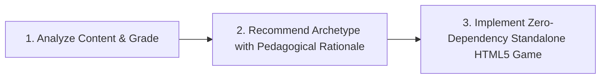

# IB PYP HTML5 Generator 🎮 🌍

[](LICENSE)
[](https://skills.sh/)
[-orange.svg)](https://www.ibo.org/programmes/primary-years-programme/)
[](https://ibpyp.szpt.org)
[](#features)

An AI Agent Skill and pedagogical blueprint library designed to build standalone, responsive HTML5 educational games and interactive learning manipulatives for **IB Primary Years Programme (PYP)** students (Grades 1–5, ages 6–12).

> **Upstream Origin & Live Demo:**  
> This standalone skill is extracted and maintained from the parent repository [szkane/IB_PYP_Games](https://github.com/szkane/IB_PYP_Games).  
> 🌟 Explore the live game collection and interactive learning hub at **[https://ibpyp.szpt.org](https://ibpyp.szpt.org)**.

---

## 🌟 Overview

The **IB PYP HTML5 Generator** equips AI coding agents (such as Antigravity, Gemini CLI, Claude Code, Cursor, Codex, and Copilot) with deep pedagogical knowledge, interaction patterns, and zero-dependency HTML5 starter templates. Rather than generating dry, multiple-choice text quizzes, this skill guides agents to recommend and construct rich, kid-friendly inquiry activities:

- **100% Standalone & Zero-Dependency**: Every generated activity is a single, self-contained HTML5 file with embedded CSS and vanilla JavaScript. No complex build pipelines or bundlers are required to run or play them.
- **9 Differentiated Game Archetypes**: From physical printable handwriting worksheets to Three.js 3D spatial inspectors, continuous concept labs, and MediaPipe computer-vision tracking.
- **IB PYP Pedagogical Grounding**: Seamlessly aligns every game with PYP transdisciplinary themes, key concepts, learner profile attributes, ATL (Approaches to Teaching and Learning) skills, and the inquiry cycle.
- **Child-Centered Interaction Standards**: Implements explore-first discovery flows, zero pre-selection challenge states, gentle submission guards, strictly zero startup audio alarms, and age-calibrated vocabulary.
- **Kid-Friendly Neobrutalism Design System**: High-contrast candy colors, tactile button depression, compact sticky-free headers, and responsive layouts tailored for iPad landscape classrooms.
- **Multimodal Accessibility**: Pure Web Audio API synthesized sound effects and switchable-accent SpeechSynthesis (TTS) read-aloud with graceful browser-default fallbacks.

---

## 🎮 The 9 Core Interactive Game Archetypes

Every generated activity is intentionally mapped to an interactive archetype tailored to its cognitive learning objective:

| # | Archetype | Starter Blueprint | Cognitive Domain & Primary Use Cases |
| :-: | :--- | :--- | :--- |
| **1** | **Worksheet Generator & Print** | [`examples/worksheet-print-starter.html`](examples/worksheet-print-starter.html) | Physical handwriting, Chinese Tian Zi Ge / Mi Zi Ge stroke practice, column math grids, `@media print` A4 homework sheets. |
| **2** | **Multimedia Flashcards & Audio** | [`examples/flashcards-starter.html`](examples/flashcards-starter.html) | Sight words, phonics pronunciation, vocabulary definitions, 3D card flips with TTS voice read-aloud and recall checks. |
| **3** | **Concept Labs & Manipulatives** | [`examples/concept-lab-starter.html`](examples/concept-lab-starter.html) | Continuous scientific and math variables (sound waves, 2D angles, row×column multiplication arrays, interactive clock hands). |
| **4** | **3D Spatial Inspectors** | [`examples/spatial-3d-starter.html`](examples/spatial-3d-starter.html) | Three.js orbit viewing, 3D solid geometry (faces, edges, vertices), planetary orbits, and light/shadow occlusion. |
| **5** | **Computer Vision & Gestures** | [`examples/gesture-tracking-starter.html`](examples/gesture-tracking-starter.html) | Kinesthetic movement play, MediaPipe Hands webcam pinch & palm tracking (with seamless mouse/touch fallback). |
| **6** | **Sequence Builders & Retell** | [`examples/sequence-builder-starter.html`](examples/sequence-builder-starter.html) | Chronological timelines, 5-Finger Story Retell (*Setting, Character, Problem, Event, Solution*), and circular life cycles. |
| **7** | **Category Sorters & Matchers** | [`examples/category-sorter-starter.html`](examples/category-sorter-starter.html) | Multi-category sorting trays, community roles & tools, living vs. non-living needs, and habitat classification. |
| **8** | **Scenario Decision Quests** | [`examples/decision-quest-starter.html`](examples/decision-quest-starter.html) | IB Learner Profile moral dilemmas (*Reflective, Caring, Balanced*), trade-offs, and multi-meter status gauges (⚡, 🍎, 😊). |
| **9** | **Speed Arcades & Diagnostics** | [`examples/speed-arcade-starter.html`](examples/speed-arcade-starter.html) | Rapid automaticity sprints (multiplication, sight word popping) and diagnostic sentence clinics with calm warm-up screens. |

---

## 🚀 Installation & Agent Setup

### Method 1: Universal CLI via skills.sh (Recommended)

Install in seconds using the universal AI agent package manager [`skills.sh`](https://skills.sh/) (`vercel-labs/skills`). This automatically detects your active coding agent (Claude Code, Cursor, Codex, OpenCode, Windsurf, Antigravity, etc.) and configures the skill in the appropriate directory:

```bash
# Add to current project / workspace
npx skills add szkane/ib-pyp-html5-generator

# Or install globally for all projects across your system
npx skills add szkane/ib-pyp-html5-generator -g

# Target a specific AI coding agent (e.g., cursor, claude-code, codex)
npx skills add szkane/ib-pyp-html5-generator -a cursor
```

### Method 2: Git Subtree (For Monorepos & Downstream Forks)

If you are maintaining a repository (such as [IB_PYP_Games](https://github.com/szkane/IB_PYP_Games)) and wish to vendor and bi-directionally sync the skill directly inside your git tree:

```bash
# Inside the root of your project:
git subtree add --prefix=.agents/skills/ib-pyp-html5-generator https://github.com/szkane/ib-pyp-html5-generator.git main --squash

# To pull upstream updates in the future:
git subtree pull --prefix=.agents/skills/ib-pyp-html5-generator https://github.com/szkane/ib-pyp-html5-generator.git main --squash
```

### Method 3: Direct Git Clone / Manual Copy

You can clone this repository directly into your local agent skills folder:

```bash
# For project-level agent skills (.agents/skills/ or .claude/skills/):
git clone https://github.com/szkane/ib-pyp-html5-generator.git .agents/skills/ib-pyp-html5-generator

# Or for personal global agent configuration:
git clone https://github.com/szkane/ib-pyp-html5-generator.git ~/.gemini/config/skills/ib-pyp-html5-generator
```

### Method 4: Standalone Educational Use (No AI Agent Needed)

Teachers, students, and educators can directly open any starter file in [`examples/`](examples/) in any modern web browser (Chrome, Safari, Firefox, Edge) without running `npm install`, build steps, or local servers.

---

## 💡 How AI Agents Use This Skill

When this skill is loaded, AI coding agents automatically activate it whenever the prompt mentions IB PYP, Units of Inquiry (UOI), inquiry-based learning, or requests HTML5 educational games for young learners.

### The 3-Step Agent Workflow



1. **Pedagogical Recommendation**: The agent analyzes the topic, target grade (Grades 1–5), and cognitive domain, recommends the optimal Archetype from the 9 core types, and justifies why this archetype outperforms a static multiple-choice quiz.
2. **Scenario Detection**:
   - **Scenario 1 (Standard Repo)**: Detects `src/data/curriculum-map.json`, generates games into `src/uoi/g{grade}_{topic}.html`, registers the unit, and validates with `npm run qa:curriculum`.
   - **Scenario 2 (Custom Fork)**: Adapts to custom directory layouts and registers into the project's custom manifest format.
   - **Scenario 3 (Greenfield / Fresh Folder)**: Creates a single standalone game or an instant `index.html` navigation hub with zero external dependencies.
3. **Execution with Interaction Standards**: The agent copies blueprints from [`examples/`](examples/), applies Neobrutalism styling tokens from [`references/design-system.md`](references/design-system.md), injects Web Audio SFX from [`references/audio-and-interaction.md`](references/audio-and-interaction.md), and embeds the switchable TTS reader from [`references/tts-pattern.md`](references/tts-pattern.md).

### Example User Prompts

- *"Build an inquiry game for Grade 2 students on sound waves and how vibration creates high/low pitch."*
  $\rightarrow$ Agent recommends **Type 3: Concept Lab & Manipulative** with an interactive SVG waveform generator and Web Audio oscillator.
- *"Create a Grade 3 activity on community workers and public services."*
  $\rightarrow$ Agent recommends **Type 7: Category Sorter & Matcher** with interactive sorting bins and audio clues.
- *"Design a Grade 1 phonics and handwriting worksheet for practice at home."*
  $\rightarrow$ Agent recommends **Type 1: Worksheet Generator & Print** with dynamic A4 print layouts, stroke grids, and live TTS pronunciation preview.

---

## 📁 Repository Structure

```text
ib-pyp-html5-generator/
├── SKILL.md                          # Main AI Agent skill instruction & specification
├── README.md                         # Project documentation and quick-start guide
├── LICENSE                           # MIT License
├── evals/
│   └── evals.json                    # Evals and test prompts for skill triggering & quality
├── examples/                         # Zero-dependency, standalone starter blueprints
│   ├── category-sorter-starter.html  # Archetype 7: Multi-category sorting
│   ├── concept-lab-starter.html      # Archetype 3: Continuous variable labs
│   ├── decision-quest-starter.html   # Archetype 8: Learner profile scenario quest
│   ├── flashcards-starter.html       # Archetype 2: 3D flip card with TTS read-aloud
│   ├── gesture-tracking-starter.html # Archetype 5: MediaPipe hands camera gesture play
│   ├── sequence-builder-starter.html # Archetype 6: Timeline & 5-finger retell builder
│   ├── spatial-3d-starter.html       # Archetype 4: Three.js 3D solid & orbital viewer
│   ├── speed-arcade-starter.html     # Archetype 9: Rapid automaticity & diagnostic clinic
│   └── worksheet-print-starter.html  # Archetype 1: A4 print generator & stroke practice
└── references/                       # Decoupled pedagogical & technical reference manuals
    ├── audio-and-interaction.md      # Pure Web Audio synthesizer & interaction etiquette
    ├── design-system.md              # Neobrutalism CSS tokens & iPad landscape guidelines
    ├── game-archetypes.md            # Comprehensive archetype decision matrix & specs
    ├── pyp-framework.md              # PYP themes, concepts, ATL, & grade language levels
    └── tts-pattern.md                # Multi-accent speech synthesis & browser fallbacks
```

---

## 📋 Version History

Based on the Git commit history of this skill:

### v2.0.0 (2026-10-19)
- **9 Core Interactive Game Archetypes**: Standardized game types with comprehensive comparison matrix and selection protocol.
- **Zero-Dependency Starter Blueprints**: Added standalone HTML5 starter templates in `examples/` for all 9 archetypes (including A4 print worksheet generators and Three.js 3D inspectors).
- **Decoupled Reference Architecture**: Reorganized guidelines into modular reference guides (`game-archetypes.md`, `pyp-framework.md`, `design-system.md`, `tts-pattern.md`, `audio-and-interaction.md`).

### v1.4.0 (2026-10-18)
- **Web Debugging Tool Hierarchy**: Established testing tool selection priority (`workbuddy-browser-use` > `agent-browser` > `playwright`).
- **Robust TTS Fallback Logic**: Added automatic fallback to browser/system default voices whenever regional English voice packs are absent.

### v1.3.0 (2026-10-18)
- **Scenario-Based Project Workflows**: Added dedicated workflows for Scenario 1 (Standard Repo), Scenario 2 (Customized Forks), and Scenario 3 (Greenfield/Independent Projects).
- **Safe Curriculum Integration**: Protected standard repository structure and verification scripts (`qa:curriculum`).

### v1.2.0 (2026-10-18)
- **Decoupling from Rigid Build Tools**: Removed mandatory bundler assumptions, enabling standalone HTML5 output ready for static hosting or file viewing.
- **Adaptive Project Discovery**: Enabled automatic detection of workspace layouts and manifests.

### v1.1.0 (2026-10-17)
- **Explore-First Sequence**: Enforced two-step learning flow (free exploration before challenge missions).
- **Strict Interaction Rules**: Introduced zero pre-selection challenge state, gentle submission guards, and zero startup audio policy.
- **Grade-Level Language Standards**: Added calibrated sentence lengths and vocabulary rules for Grades 1–5.

### v1.0.0 (2026-10-06)
- **Initial Release**: Launched `ib-pyp-html5-generator` skill supporting IB PYP game generation, Neobrutalism styling, and multi-accent TTS voice selectors.

---

## 📄 License

This project is licensed under the [MIT License](LICENSE).  
Copyright (c) 2025–2026 Kane.
