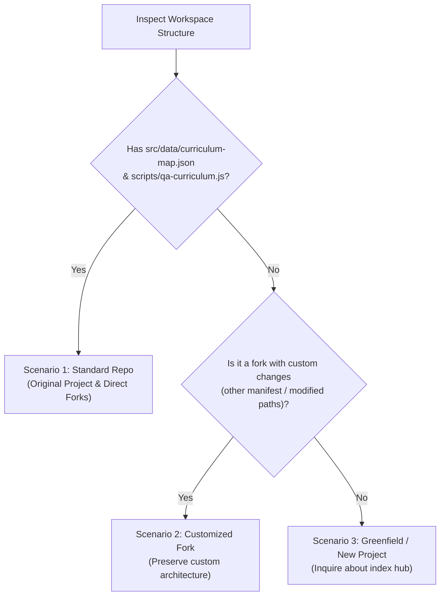

# IB PYP HTML5 Generator

The core purpose of this skill is to help users design and build standalone HTML5 IB inquiry interactive web games (HTML5 + CSS + vanilla JavaScript), enabling students in the IB PYP phase (Grades 1–5, ages 6–12) to conduct in-depth exploration, inquiry, and hands-on learning of curriculum concepts.

This skill is **100% self-contained and project-agnostic**: it bundles complete, zero-dependency starter templates for all 9 game archetypes in [`examples/`](examples/), while using **scenario-based workflows** to seamlessly support the original repository, customized forks, and brand-new greenfield projects.

---

## Reference files (read when needed)

| File | Read it when |
| --- | --- |
| [references/game-archetypes.md](references/game-archetypes.md) | **Read First**: Selecting and recommending interactive game types—decision matrix, contrastive rationales (When to choose X vs. Y), master gameplay comparison table, and technical specs for all 9 archetypes |
| [examples/](examples/) | **Self-Contained Starter Templates**: Complete, zero-dependency HTML5 blueprints for all 9 archetypes (`worksheet-print`, `flashcards`, `concept-lab`, `spatial-3d`, `gesture-tracking`, `sequence-builder`, `category-sorter`, `decision-quest`, `speed-arcade`) ready to adapt in ANY project |
| [references/pyp-framework.md](references/pyp-framework.md) | Unpacking a unit: themes, key concepts, learner profile, ATL, inquiry cycle, PBL mapping, mechanic ideas per theme, and Section 10 Grade-Level Language Standards |
| [references/design-system.md](references/design-system.md) | Writing CSS/HTML: Neobrutalism tokens, page skeleton, compact header, iPad landscape rules |
| [references/tts-pattern.md](references/tts-pattern.md) | Any text a child should hear: accent dropdown, `TTS_MANAGER`, speaker buttons, when to auto-speak |
| [references/audio-and-interaction.md](references/audio-and-interaction.md) | Sound effects, zero pre-selection pattern, explore-first flow, audio etiquette, 3D scenes |

---

## Step 1: Interactive Game Archetypes & Recommendation Protocol (Universal)

Every interactive activity must be intentionally structured around a well-defined **Game Archetype** selected from the 9 core types documented in [`references/game-archetypes.md`](references/game-archetypes.md). **Never default to generic, dry multiple-choice text quizzes** when a tactile manipulative, printable grid, visual simulation, or narrative sorting mechanic fits the learning goal.

### The 9 Core Interactive Archetypes & Bundled Starters

| # | Archetype Name | Bundled Starter Template | Best Used For |
| :--- | :--- | :--- | :--- |
| **1** | **Worksheet Generator & Print** | [`examples/worksheet-print-starter.html`](examples/worksheet-print-starter.html) | Physical handwriting, Chinese Tian Zi Ge / Mi Zi Ge stroke order, vertical/horizontal math columns, A4 `@media print` homework |
| **2** | **Multimedia Flashcards & Audio** | [`examples/flashcards-starter.html`](examples/flashcards-starter.html) | Sight words, vocabulary definitions, phonics pronunciation, 3D card flips with TTS read-aloud & recall quizzes |
| **3** | **Concept Labs & Manipulatives** | [`examples/concept-lab-starter.html`](examples/concept-lab-starter.html) | Continuous scientific/math cause-and-effect (sound waves, 2D angles, row×column arrays, clock hands, gear ratios) |
| **4** | **3D Spatial Inspectors** | [`examples/spatial-3d-starter.html`](examples/spatial-3d-starter.html) | 3D spatial depth, Three.js orbit viewing, light & shadow occlusion, 3D solid geometry (faces/edges/vertices), orbits |
| **5** | **Computer Vision & Gestures** | [`examples/gesture-tracking-starter.html`](examples/gesture-tracking-starter.html) | Kinesthetic whole-body play, MediaPipe Hands webcam pinch/open-palm tracking (with automatic touch/mouse fallback) |
| **6** | **Sequence Builders & Retell** | [`examples/sequence-builder-starter.html`](examples/sequence-builder-starter.html) | Chronological timelines, 5-Finger Story Retell (*Setting, Character, Problem, Event, Solution*), circular life cycles |
| **7** | **Category Sorters & Matchers** | [`examples/category-sorter-starter.html`](examples/category-sorter-starter.html) | Conceptual classification, community roles & tools, living vs. non-living needs, habitat sorting into multi-category bins |
| **8** | **Scenario Decision Quests** | [`examples/decision-quest-starter.html`](examples/decision-quest-starter.html) | IB Learner Profile (*Balanced, Reflective, Caring*) dilemmas, goal setting, multi-meter gauges (Energy ⚡, Health 🍎, Mood 😊) |
| **9** | **Speed Arcades & Diagnostics** | [`examples/speed-arcade-starter.html`](examples/speed-arcade-starter.html) | Timed automaticity sprints (multiplication, phonics popping) and diagnostic "Sentence Doctor" token clinics |

### 3-Step Recommendation & Gameplay Specification Workflow

Whenever a user describes the learning content or topic they want to build, execute these 3 steps before writing code:

1. **Analyze Learning Content & Cognitive Domain**:
   - Identify target grade (Grades 1–5), PYP transdisciplinary theme, and what the learner must do cognitively (physical penmanship, vocabulary recall, continuous variable experimentation, 3D spatial inspection, kinesthetic movement, chronological ordering, categorical grouping, ethical trade-offs, or rapid fluency/error-spotting).
2. **Recommend Suitable Archetype(s) with Contrastive Rationale**:
   - Recommend **1 Primary Archetype** (and 1 Secondary or Hybrid option if helpful) from [`references/game-archetypes.md`](references/game-archetypes.md).
   - Provide the **Pedagogical Rationale**: explain *why* this archetype fits the content and why it is superior to static text or alternative archetypes (e.g., why **Type 4: 3D Spatial Inspector** is chosen over a 2D quiz for shadow formation, or why **Type 1: Worksheet & Print** is chosen for handwriting and arithmetic stamina).
3. **Clarify Differentiated Interactive Gameplay**:
   - Explicitly outline how the constructed gameplay works under the chosen archetype:
     - **Step 1 (Explore / Setup Mode)** vs. **Step 2 (Challenge / Output Mode)**
     - **Interactive Manipulatives & Controls** (e.g., A4 print parameter sidebar & Tian Zi Ge CSS; SVG drag sliders & Web Audio oscillators; Three.js orbit & shadow maps; multi-attribute status bars; or clickable diagnostic word tokens)
     - **State & Feedback Loop** (zero pre-selection `null` initial state, formative explanations, audio chimes).
   - Read the corresponding starter file in [`examples/`](examples/) as your verified structural and technical blueprint.

---

## Step 2: Scenario-Based Project Workflows

Detect the workspace environment to determine how files should be placed, linked, and verified:



---

### Scenario 1: Standard IB PYP Games Repository (Original Project & Standard Forks)

> [!IMPORTANT]
> This is the **default workflow** when `src/data/curriculum-map.json` and `scripts/qa-curriculum.js` exist. It guarantees zero regressions for the standard repository structure.

1. **Plan & Recommend Archetype**:
   - Execute **Step 1 (Archetype Recommendation Protocol)** above and read the matching starter in [`examples/`](examples/).
   - Unpack PYP elements: Theme, Central Idea, Lines of Inquiry, Key Concepts, Learner Profile attributes, and ATL skills (see [`references/pyp-framework.md`](references/pyp-framework.md)).
   - Name the file with grade prefix: `src/uoi/g{grade}_{topic_in_snake_case}.html` (e.g., `src/uoi/g3_water_cycle_quest.html`).

2. **Author the Standalone Game File in `src/uoi/`**:
   - Implement as a self-contained HTML5 file with embedded `<style>` and `<script>` blocks.
   - Follow all **Core Pedagogical & Interaction Standards** (Step 3 below).
   - Return navigation link: `<a class="pyp-map-link" href="../index.html">← PYP Map</a>`.

3. **Register in `src/data/curriculum-map.json`**:
   - Add the game entry to the corresponding Grade $\rightarrow$ Unit $\rightarrow$ Subject lane (`uoi`).
   - Ensure `theme`, `centralIdea`, `learnerProfile`, and `atlSkills` fields on the unit are complete.
   - Write a concise, curriculum-aligned `description`.
   - **Never manually edit `src/index.html`**; it is auto-generated from this map.

4. **Verify Curriculum & Build**:
   ```bash
   npm run qa:curriculum
   npm run build
   ```
   - `npm run qa:curriculum` ensures coverage, valid links, standalone rules, and return anchors.
   - `npm run build` auto-regenerates `src/index.html` and bumps the Service Worker cache version.

5. **Test in Browser & iPad Landscape (Web Debugging Protocol)**:
   - Start the Vite dev server (`npm run dev`) or test via `http://localhost:5173/uoi/g{grade}_{topic}.html`.
   - **Web Debugging Tool Selection**: Select exactly **one** browser tool in accordance with this strict priority order:
     - **If the current AI harness is WorkBuddy**: Use `workbuddy-browser-use`.
     - **Standard Priority Order**:
       1. `agent-browser` (Priority 1)
       2. `playwright` (or `playwright-cli`, Priority 2)
   - Verify viewports: Desktop and iPad landscape (1180×820 / 1024×768). Check that controls are visible without excessive vertical scrolling and touch targets are $\ge 44$px.
   - Verify console logs: Ensure 0 unhandled JS errors, no audio policy violations, and clean TTS voice loading.

---

### Scenario 2: Customized Forked Projects

> [!NOTE]
> Used when users have forked a repository and introduced custom directory structures, alternative build systems, or customized manifest schemas.

1. **Plan & Recommend Archetype**:
   - Execute **Step 1 (Archetype Recommendation Protocol)** and read the matching blueprint in [`examples/`](examples/).
   - Identify how the fork differs from the standard layout (e.g., game folder changed to `games/`, custom manifest, or custom scripts in `package.json`).
2. **Preserve Custom Architecture & Adapt Blueprint**:
   - Place the new standalone game in the project's designated games directory, adapting the corresponding starter template from [`examples/`](examples/).
   - Adapt the return link relative path to point to the user's hub (e.g., `../index.html` or `index.html`).
   - Assist the user in registering the game inside their custom manifest/registry format.
3. **Execute Custom Validation & Web Debugging**:
   - Run the fork's specific build, test, or lint scripts if configured, ensuring compatibility without forcing default repo assumptions.
   - For web visual inspection and debugging, adhere to the tool priority: `workbuddy-browser-use` (in WorkBuddy) > `agent-browser` > `playwright`.

---

### Scenario 3: Greenfield / Independent Projects

> [!NOTE]
> Used when running in an independent repository or a fresh directory with no existing curriculum map or build tools.

1. **Recommend Archetype & Inquire About Project Hub**:
   - Execute **Step 1 (Archetype Recommendation Protocol)**: recommend the best archetype(s), explain the pedagogical rationale, and clarify the differentiated gameplay mechanics.
   - Ask the user whether they would like to:
     - **Option A (Recommended - Hub + Game)**: Create an `index.html` navigation hub linking to standalone inquiry games in a `uoi/` or `games/` directory.
     - **Option B (Single Standalone Game)**: Create a standalone single `.html` game file with no extra scaffolding.
2. **Generate the Files Using Bundled Examples**:
   - Read and adapt the matching starter template from [`examples/`](examples/) (`worksheet-print-starter.html`, `flashcards-starter.html`, `concept-lab-starter.html`, `spatial-3d-starter.html`, `gesture-tracking-starter.html`, `sequence-builder-starter.html`, `category-sorter-starter.html`, `decision-quest-starter.html`, or `speed-arcade-starter.html`).
   - Author the standalone `.html` game with zero external build dependencies (embedded CSS/JS, pure Web Audio API, browser native SpeechSynthesis TTS with default fallback).
   - If Option A was selected, generate or update the central `index.html` hub with responsive activity cards, grade filters, and unit metadata badges.
3. **Deliver & Verify**:
   - Deliver the files. The user can run them directly by double-clicking the `.html` file, serving via any static server, or hosting on GitHub Pages with zero `npm` installation required.
   - When verifying page rendering or touch controls, use the debugging tool priority: `workbuddy-browser-use` (in WorkBuddy) > `agent-browser` > `playwright`.

---

## Step 3: Core Pedagogical & Interaction Standards (Universal)

Regardless of the scenario or archetype, every generated game must follow these non-negotiable rules:

### 1. Explore-First Sequence (Two-Step Flow)
- **Step 1 (Free Discovery / Setup)**: Children freely tap, listen, manipulate variables, or configure parameters first with zero test pressure (and in Type 9 Speed Arcades, start in a calm Ready/Warm-up screen rather than auto-starting countdown timers on page load).
- **Step 2 (Challenge / Mission / Output)**: Hands-on problem-solving applying what was discovered in Step 1 (or printable A4 output / dictation in Type 1). Always provide an easy way to switch back to Step 1.

### 2. Strict Grade-Level Language Calibration
- **Grade 1 (Age 6–7)**: 5–10 words per sentence, basic sight words, concrete nouns, emoji on every noun, TTS auto-speak enabled.
- **Grade 2 (Age 7–8)**: 8–14 words per sentence, high-frequency vocabulary, direct cause-and-effect, relatable real-world metaphors (e.g., T-Rex stomp, baby bird calling mom, ambulance clearing traffic). Avoid obscure adult terms (use "sunglasses 🕶️" not "frosted wax", "deep ocean 🌊" not "abyss").
- **Grade 3–5 (Age 8–11)**: 12–18 words per sentence, structured scientific/social terms introduced in context, multi-step inquiry.
- *Follow `references/pyp-framework.md#10-grade-level-language--storytelling-standards-age-611` for prompt, clue, and feedback wording.*

### 3. Zero Pre-Selection in Challenges
- Challenge/mission buttons must **never** be pre-selected in HTML markup or initial JS state.
- All choices initialize to `null`, buttons remain neutral, and badges show `❓ Tap to choose` with dashed borders.
- Switching between challenge cases automatically resets uncompleted choices to `null` and clears `.active` classes.

### 4. Gentle Guard Checks Before Submission
- If a child taps the action/submit button before selecting all required choices, do NOT penalize or check empty values. Show a warm upward nudge (e.g., *"👆 Please choose both a Pitch and a Volume first!"*).

### 5. Clear Case Navigation
- Present one challenge at a time with visible case tabs (`[Case 1] [Case 2] [Case 3]`). Solved cases receive a green background and `✅` checkmarks.
- Context-aware controls: only show inputs and previews relevant to the active case.

### 6. Audio Etiquette on Page Load
- Strictly **zero sound effects on page load**. `DOMContentLoaded` runs with `playSound = false` so sirens, alarms, and roars never startle young children or trigger browser audio policy blocks.
- Sounds only trigger on explicit user touch/click.

### 7. Neobrutalism Design System & iPad Landscape
- Bold black borders (`3.5px solid #111`), hard offset drop shadows (`4px 4px 0 #111`), candy colors, tactile button depression (`translate(2px, 2px)`).
- Compact header (one nav row + one small hero, no sticky banners eating vertical height).
- Responsive two-column play grid (`1.2fr 1fr` in landscape, stacked on narrow mobile).
- Large touch targets ($\ge 44$px height/width, `touch-action: manipulation`). Use `100dvh` for full-height views.
- For **Type 1 (Worksheet & Print)**, include `@page { size: A4 portrait; margin: 8mm 10mm; }` and `@media print` rules that strip screen UI, enforce ink-friendly black-on-white (`print-color-adjust: exact`), and prevent mid-item page breaks (`break-inside: avoid`).

### 8. Voice Read-Aloud (TTS) with Robust Fallback & Web Audio SFX
- **Switchable Accent TTS**: Copy the accent dropdown and `TTS_MANAGER` from [`references/tts-pattern.md`](references/tts-pattern.md) verbatim. Persists voice choice across activities via `localStorage['ib_pyp_voice_name']`. Provide 🔊 `.btn-speaker` buttons next to titles, prompts, stories, and clues.
- **Mandatory TTS Fallback Logic**:
  - Filter for US, UK, AU, and EN-related voices (`lang.startsWith('en')`).
  - **Browser Default Fallback**: If the browser or operating system does NOT have US or EN-related TTS voice resources installed, automatically fallback to the browser's default TTS (`voices.find(v => v.default) || voices[0]`). Speech synthesis must never fail silently.
- **Pure Web Audio Synthesizer**: Include the zero-dependency `SoundFX` synthesizer class from [`references/audio-and-interaction.md`](references/audio-and-interaction.md) (click, correct chime, gentle buzz, fanfare). Unlocked automatically on first user touch/click.

---

## Quality Checklist

- [ ] **Archetype Recommended & Rationalized**: Selected the optimal archetype from the 9 core types in `references/game-archetypes.md`, explained the pedagogical rationale (and why it outperforms alternatives), and adapted the corresponding starter in `examples/`.
- [ ] **Scenario Respected**:
  - *Scenario 1 (Standard Repo)*: Placed in `src/uoi/`, registered in `src/data/curriculum-map.json`, `npm run qa:curriculum` and `npm run build` pass, return link points to `../index.html`.
  - *Scenario 2 (Custom Fork)*: Adapted to custom folder/manifest structure, custom QA/build scripts respected.
  - *Scenario 3 (Independent / New Project)*: User was asked about creating an index hub; standalone file delivered with zero external repo dependencies.
- [ ] **Web Debugging Tool Hierarchy Used**: Visual and browser testing executed following: `workbuddy-browser-use` (if in WorkBuddy harness) > `agent-browser` (Priority 1) > `playwright` (Priority 2).
- [ ] **IB PYP Alignment**: Traces clearly to transdisciplinary theme, central idea, lines of inquiry, key concepts, learner profile, and ATL skills.
- [ ] **Explore-First Sequence**: Free exploration/discovery (Step 1) precedes challenge/mission (Step 2), with an easy return path and no auto-running countdown timers on load.
- [ ] **Grade-Level Language**: Short sentences (8–14 words for G2), sight words, concrete everyday examples, zero adult academic jargon.
- [ ] **Zero Pre-Selection**: Challenge buttons start unselected; state variables initialized to `null`; badges show `❓ Tap to choose`.
- [ ] **Case Navigation & State Reset**: Visible case tabs (`[Case 1] [Case 2] [Case 3]`), unsolved choices reset on case switch, guard checks on empty submit.
- [ ] **Audio Etiquette**: Strictly zero sound effects auto-playing on page load; audio only triggers on explicit user gestures.
- [ ] **Neobrutalism UI, iPad Landscape & Print Precision**: Bold borders (`3.5px #111`), hard drop shadows (`4px 4px 0 #111`), compact header; for Type 1 print pages, verified `@page { size: A4 portrait }` and `@media print` rules.
- [ ] **TTS Read-Aloud & Fallback**: Top-right accent dropdown present; 🔊 buttons on prompts; voice choice saved in `localStorage`; **browser default TTS fallback implemented if US/EN voices are missing**.
- [ ] **Synthetic Audio**: Pure Web Audio API SFX; unlocks on first gesture; silent graceful degradation if audio is unavailable.
