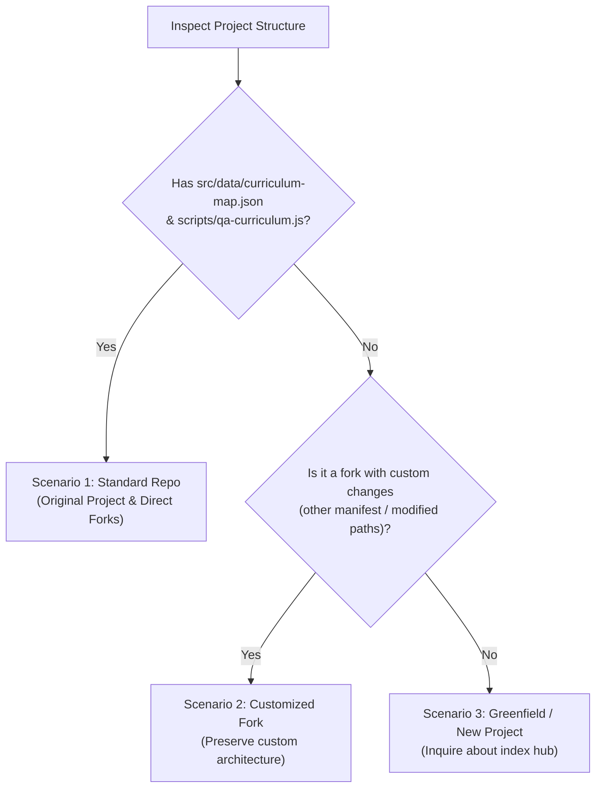

# IB PYP HTML5 Generator

The core purpose of this skill is to help users create standalone HTML-based IB inquiry interactive web games (HTML5 + CSS + vanilla JavaScript), enabling students in the IB PYP phase (Grades 1–5, ages 6–12) to conduct in-depth exploration, inquiry, and hands-on learning of curriculum concepts.

To ensure **stable ongoing operation for the original project** while seamlessly supporting forked or greenfield projects, this skill uses **scenario-based workflows**.

---

## Reference files (read when needed)

| File | Read it when |
| --- | --- |
| [references/pyp-framework.md](references/pyp-framework.md) | Unpacking a unit: themes, key concepts, learner profile, ATL, inquiry cycle, PBL mapping, mechanic ideas per theme, and Section 10 Grade-Level Language Standards |
| [references/design-system.md](references/design-system.md) | Writing CSS/HTML: Neobrutalism tokens, page skeleton, compact header, iPad landscape rules |
| [references/tts-pattern.md](references/tts-pattern.md) | Any text a child should hear: accent dropdown, `TTS_MANAGER`, speaker buttons, when to auto-speak |
| [references/audio-and-interaction.md](references/audio-and-interaction.md) | Sound effects, zero pre-selection pattern, explore-first flow, audio etiquette, 3D scenes |

---

## Scenario-Based Workflows

Always detect the project environment first to determine the correct workflow:



---

### Scenario 1: Standard IB PYP Games Repository (Original Project & Standard Forks)

> [!IMPORTANT]
> This is the **primary, default workflow**. It guarantees zero regressions and stable ongoing operation for the original `IB_PYP_Games` repo and any standard fork that shares its structure.

1. **Locate & Plan the Unit Activity**:
   - Determine Grade (1–5), Unit of Inquiry (1–6), and learning objective.
   - Name the file with grade prefix: `src/uoi/g{grade}_{topic_in_snake_case}.html` (e.g., `src/uoi/g2_sound_and_light_studio.html`).
   - Unpack PYP elements: Theme, Central Idea, Lines of Inquiry, Key Concepts, Learner Profile attributes, and ATL skills (see `references/pyp-framework.md`).

2. **Author the Standalone Game File in `src/uoi/`**:
   - Implement as a self-contained HTML5 file with embedded `<style>` and `<script>` blocks.
   - Follow all **Core Pedagogical & Interaction Standards** (Section 3 below):
     - Explore-First two-step sequence (Discovery Step 1 $\rightarrow$ Mission Step 2).
     - Strict grade-level language calibration (short sentences, concrete examples).
     - Zero pre-selection in challenges (`null` initial state, `❓ Tap to choose` badges).
     - Clear case tabs with active case resets and gentle guard checks on empty submit.
     - Strict audio etiquette: **zero sound effects on page load**.
     - Neobrutalism design system tokens and iPad landscape layout (`100dvh`, compact header).
     - Switchable-accent native TTS read-aloud and zero-dependency Web Audio SFX.
   - Return navigation link: `<a class="pyp-map-link" href="../index.html">← PYP Map</a>`.

3. **Register in `src/data/curriculum-map.json`**:
   - Add the game entry to the corresponding Grade $\rightarrow$ Unit $\rightarrow$ Subject lane (`uoi`).
   - Ensure `theme`, `centralIdea`, `learnerProfile`, and `atlSkills` fields on the unit are complete.
   - Use `path` for standard links or `href` if query parameters are needed.
   - Write a concise, curriculum-aligned `description`.
   - **Never manually edit `src/index.html`**; it is auto-generated from this map.

4. **Verify Curriculum & Build**:
   ```bash
   npm run qa:curriculum
   npm run build
   ```
   - `npm run qa:curriculum` ensures coverage, valid links, standalone rules, and return anchors.
   - `npm run build` auto-regenerates `src/index.html` and bumps the Service Worker cache version.

5. **Test in Browser & iPad Landscape**:
   - Start the Vite dev server (`npm run dev`) or test via `http://localhost:5173/uoi/g{grade}_{topic}.html`.
   - Verify viewports: Desktop and iPad landscape (1180×820 / 1024×768). Check that controls are visible without excessive vertical scrolling and touch targets are $\ge 44$px.

---

### Scenario 2: Customized Forked Projects

> [!NOTE]
> Used when users have forked the repository and introduced custom directory structures, alternative build systems, or customized manifest schemas.

1. **Inspect Customization**:
   - Identify how the fork differs from the standard layout (e.g. game folder changed from `src/uoi/` to `games/`, manifest renamed or reformatted, custom scripts in `package.json`).
2. **Preserve Custom Architecture**:
   - Place the new standalone game in the project's designated games directory.
   - Adapt the return link relative path to point to the user's hub (e.g. `../index.html` or `index.html`).
   - Assist the user in registering the game inside their custom manifest/registry format.
3. **Execute Custom Validation**:
   - Run the fork's specific build, test, or lint scripts if configured, ensuring compatibility without forcing default repo assumptions.

---

### Scenario 3: Greenfield / New Projects

> [!NOTE]
> Used when starting in a fresh directory with no existing project structure or build tools.

1. **Inquire About Project Hub**:
   - Ask the user whether they would like to:
     - **Option A (Recommended - Standard Hub Structure)**: Create an `index.html` navigation map hub linking to standalone inquiry games in a `uoi/` directory (adopting the proven IB PYP Games layout).
     - **Option B (Single Standalone Game)**: Create a standalone single `.html` game file with no repository scaffolding.
2. **Generate the Files**:
   - Author the standalone `.html` game with zero external dependencies (embedded CSS/JS, pure Web Audio API, browser native SpeechSynthesis TTS).
   - If Option A was selected, generate or update the central `index.html` hub with responsive activity cards, grade filters, and unit metadata badges.
3. **Deliver & Verify**:
   - Deliver the files. The user can run them directly by double-clicking the `.html` file, serving via any static server, or hosting on GitHub Pages with zero npm installation required.

---

## Core Pedagogical & Interaction Standards (Universal)

Regardless of the scenario, every generated game must follow these non-negotiable rules:

### 1. Explore-First Sequence (Two-Step Flow)
- **Step 1 (Free Discovery & Sandbox)**: Children freely tap, listen, manipulate, and observe real-world concepts first with zero pressure (e.g. hearing animals, dragging lights, testing materials).
- **Step 2 (Challenge / Mission)**: Hands-on problem-solving applying what was discovered in Step 1. Always provide an easy `[⬅️ Back to Explore]` button so children can revisit concepts anytime.

### 2. Strict Grade-Level Language Calibration
- **Grade 1 (Age 6–7)**: 5–10 words per sentence, basic sight words, concrete nouns, emoji on every noun, TTS auto-speak enabled.
- **Grade 2 (Age 7–8)**: 8–14 words per sentence, high-frequency vocabulary, direct cause-and-effect, relatable real-world metaphors (e.g. T-Rex stomp, baby bird calling mom, ambulance clearing traffic). Avoid obscure adult terms (use "sunglasses 🕶️" not "frosted wax", "deep ocean 🌊" not "abyss").
- **Grade 3–5 (Age 8–11)**: 12–18 words per sentence, structured scientific/social terms introduced in context, multi-step inquiry.
- *Follow `references/pyp-framework.md#10-grade-level-language--storytelling-standards-age-611` for prompt, clue, and feedback wording.*

### 3. Zero Pre-Selection in Challenges
- Challenge/mission buttons must **never** be pre-selected in HTML markup or initial JS state.
- All choices initialize to `null`, buttons remain neutral, and badges show `❓ Tap to choose` with dashed borders.
- Switching between challenge cases automatically resets uncompleted choices to `null` and clears `.active` classes.

### 4. Gentle Guard Checks Before Submission
- If a child taps the action/submit button before selecting all required choices, do NOT penalize or check empty values. Show a warm upward nudge (e.g., *"👆 Please choose both a Pitch and a Volume first!"*).

### 5. Clear Case Navigation
- Present one challenge at a time with visible case tabs (`[Case 1] [Case 2] [Case 3]`). Solved cases receive a green background and `✅` checkmarks.
- Context-aware controls: only show inputs and previews relevant to the active case.

### 6. Audio Etiquette on Page Load
- Strictly **zero sound effects on page load**. `DOMContentLoaded` runs with `playSound = false` so sirens, alarms, and roars never startle young children or trigger browser audio policy blocks.
- Sounds only trigger on explicit user touch/click.

### 7. Neobrutalism Design System & iPad Landscape
- Bold black borders (`3.5px solid #111`), hard offset drop shadows (`4px 4px 0 #111`), candy colors, tactile button depression (`translate(2px, 2px)`).
- Compact header (one nav row + one small hero, no sticky banners eating vertical height).
- Responsive two-column play grid (`1.2fr 1fr` in landscape, stacked on narrow mobile).
- Large touch targets ($\ge 44$px height/width, `touch-action: manipulation`). Use `100dvh` for full-height views.

### 8. Voice Read-Aloud (TTS) & Web Audio SFX
- **Switchable Accent TTS**: Copy the accent dropdown and `TTS_MANAGER` from `references/tts-pattern.md` verbatim. Persists voice choice across activities via `localStorage['ib_pyp_voice_name']`. Provide 🔊 `.btn-speaker` buttons next to titles, prompts, stories, and clues.
- **Pure Web Audio Synthesizer**: Include the zero-dependency `SoundFX` synthesizer class from `references/audio-and-interaction.md` (click, correct chime, gentle buzz, fanfare). Unlocked automatically on first user touch/click. Operates offline without external audio files.

---

## Quality Checklist

- [ ] **Scenario Respected**:
  - *Scenario 1 (Standard Repo)*: Placed in `src/uoi/`, registered in `src/data/curriculum-map.json`, `npm run qa:curriculum` and `npm run build` pass, return link points to `../index.html`.
  - *Scenario 2 (Custom Fork)*: Adapted to custom folder/manifest structure, custom QA/build scripts respected.
  - *Scenario 3 (New Project)*: User was asked about creating an index hub; standalone file delivered with zero build requirements.
- [ ] **IB PYP Alignment**: Traces clearly to transdisciplinary theme, central idea, lines of inquiry, key concepts, learner profile, and ATL skills.
- [ ] **Explore-First Sequence**: Free exploration/discovery (Step 1) precedes challenge/mission (Step 2), with an easy return path.
- [ ] **Grade-Level Language**: Short sentences (8–14 words for G2), sight words, concrete everyday examples, zero adult academic jargon.
- [ ] **Zero Pre-Selection**: Challenge buttons start unselected; state variables initialized to `null`; badges show `❓ Tap to choose`.
- [ ] **Case Navigation & State Reset**: Visible case tabs (`[Case 1] [Case 2] [Case 3]`), unsolved choices reset on case switch, guard checks on empty submit.
- [ ] **Audio Etiquette**: Strictly zero sound effects auto-playing on page load; audio only triggers on explicit user gestures.
- [ ] **Neobrutalism UI & iPad Landscape**: Bold borders (`3.5px #111`), hard drop shadows (`4px 4px 0 #111`), compact header, fits without excessive vertical scrolling.
- [ ] **TTS Read-Aloud**: Top-right accent dropdown present; 🔊 buttons on prompts; voice choice saved in `localStorage`.
- [ ] **Synthetic Audio**: Pure Web Audio API SFX; unlocks on first gesture; silent graceful degradation if audio is unavailable.
